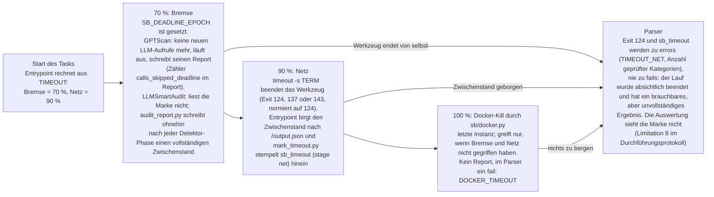

# Die Werkzeugkette als Abbildung

> Teil der Bachelorarbeit · zurück zum Überblick: [`BA-ARBEIT.md`](BA-ARBEIT.md)

Zwei Diagramme in Mermaid-Notation (GitHub stellt sie direkt dar). Sie fassen
zusammen, was `README.md` („Docker: was im Container läuft und was nicht“),
[`GPTScan/docs/SMARTBUGS_INTEGRATION.md`](../GPTScan/docs/SMARTBUGS_INTEGRATION.md)
und [`BA-AP5-TIMEOUT-DESIGN.md`](BA-AP5-TIMEOUT-DESIGN.md) im Text beschreiben —
ohne neue Inhalte oder Zahlen. Stand 24.09.2026.

## 1. Weg eines Tasks: vom Runner bis zur Auswertung

Ein Task ist ein Paar aus Werkzeug und Contract-Datei. Für jeden Task startet
SmartBugs einen eigenen Container; nichts aus einem Task bleibt für den
nächsten erhalten.

```mermaid
flowchart TD
    R["Runner: run_curated.ps1, run_full_v2.ps1, run_full_v2_llmsa.ps1, run_retry_llmsa.ps1
    liest GPTScan/.env, prüft den Schlüssel des Anbieters und den Kontostand,
    setzt LLM_* bzw. GPTSCAN_* in der Prozessumgebung,
    ruft python -m sb mit Werkzeug, Muster, Timeout, Prozessen und runid"]
    S1["sb (SmartBugs 2.1.1)
    sammelt die Tasks aus den -f Mustern (bei --main nur Dateien, die einen Contract benennen),
    wählt solc nach der pragma aus ~/.smartbugs/solc und reicht ihn als BIN/solc in den Container,
    gibt nur die Variablen weiter, die in tools/&lt;tool&gt;/config.yaml unter env: stehen"]
    C["Docker-Container (Image aus config.yaml, Netz bridge für die KI-Werkzeuge, none für Slither)
    Entrypoint BIN/do_solidity.sh FILENAME TIMEOUT BIN MAIN
    MAIN=1: main_contract.py reduziert die Datei auf den Hauptcontract
    Werkzeug läuft (GPTScan main.py, LLMSmartAudit run.py, slither)
    Entrypoint garantiert /output.json, auch als Platzhalter mit error"]
    S2["sb sammelt ein
    smartbugs.json (Aufruf, Entrypoint, Exit-Code, Dauer; Variablenwerte redigiert),
    result.log (Konsole des Containers), result.tar (/output.json)"]
    P["tools/&lt;tool&gt;/parser.py
    parse(exit_code, log, output) liefert findings, infos, errors, fails,
    findings.yaml liefert Klassifikation (SWC/DASP) und Severity je Findingname,
    Ergebnis: result.json (dazu result.sarif bei --sarif)"]
    E["Auswertung auf dem Host
    curated_eval.py / evaluate_curated.py (Recall, Precision, F1 je DASP-Kategorie),
    build_eval.py (LLMSmartAudit-Läufe), gptscan_eval.py (GPTScan-Läufe),
    per_contract_stats.py (eine Zeile je Contract),
    errors_fails_report.py und parser_audit.py über alle Läufe"]
    OUT["eval/&lt;lauf&gt;/ mit findings.jsonl, run_meta.json, summary.md, README.md
    eval/per_contract/*.csv, docs/errors-fails.md, docs/parser-audit-nachher.md"]

    R --> S1 --> C --> S2 --> P --> E --> OUT
    S2 -. "python -m sb.reparse wiederholt nur diesen Schritt" .-> P
```

Was die Abbildung absichtlich weglässt: die Rollen und Phasen innerhalb von
LLMSmartAudit (41 Detektor-Prompts, `BA-WERKZEUGE-IM-VERGLEICH.md` Abschnitt 2)
und der Trichter innerhalb von GPTScan (Vorfilter, zwei LLM-Stufen, statische
Bestätigung, Abschnitt 1 ebendort). Beides spielt sich im Kasten „Werkzeug
läuft“ ab und ändert nichts an der Kette.

## 2. Timeout-Mechanik (AP5): drei Marken aus einem TIMEOUT

SmartBugs kennt nur eine Frist je Task und tötet den Container, wenn sie
abläuft; das Ergebnis wäre ein `fail` (`DOCKER_TIMEOUT`) ohne Report. Die
Entrypoints der beiden KI-Werkzeuge rechnen deshalb aus dem übergebenen
`TIMEOUT` drei Marken aus und retten davor, was fertig ist. Mit `--timeout 0`
ist keine der Marken gesetzt, und die Kette verhält sich wie vor AP5.

Nachgewiesen ist die Mechanik in `BA-DURCHFUEHRUNGSPROTOKOLL.md` Abschnitt 4.5
(je ein Contract pro Werkzeug gegen den lokalen Prüfstand und live) und durch
`tests/test_entrypoint_timeout.py`, `tests/test_gptscan_deadline.py` und
`tests/test_audit_report_partial.py`.

## Quellen

| Kasten | Quelle im Repository |
|---|---|
| Runner | `run_curated.ps1`, `run_full_v2.ps1`, `run_full_v2_llmsa.ps1`, `run_retry_llmsa.ps1`; Variablen in `GPTScan/.env.example` |
| Task-Sammlung, solc, Allowlist | `smartbugs/sb/smartbugs.py`, `smartbugs/sb/solidity.py`, `smartbugs/sb/tools.py` und `smartbugs/sb/docker.py` (Blöcke `BA MODIFICATION`, begründet in `BA-EIGENANTEIL.md` 2.1) |
| Entrypoints | `smartbugs/tools/gptscan/scripts/do_solidity.sh`, `smartbugs/tools/llmsmartaudit/scripts/do_solidity.sh`, dazu `main_contract.py` und `mark_timeout.py` |
| Parser und Taxonomie | `smartbugs/tools/<tool>/parser.py`, `findings.yaml`; Herleitung von errors und fails in `BA-ERRORS-VS-FAILS.md`; Begründung der LLMSmartAudit-Zuordnung in `smartbugs/tools/llmsmartaudit/mapping.md` |
| Auswertung | `analysis_tools/`, `evaluate_curated.py`; Beschreibung in `eval/README.md` |
| Timeout-Marken | `BA-AP5-TIMEOUT-DESIGN.md` 4.1 bis 4.4; Docker-Kill in `smartbugs/sb/docker.py` |

## Diagramme exportieren

Wir legen bewusst keine Bilddateien ab. Wer die Diagramme als Bild braucht:

1. **GitHub:** Datei im Browser öffnen, Rechtsklick auf das Diagramm, „Bild
   speichern“.
2. **mermaid-cli:** Codeblock nach `kette.mmd` kopieren,
   `mmdc -i kette.mmd -o kette.pdf` (oder `.svg`); `mmdc` stammt aus
   `@mermaid-js/mermaid-cli` (Node.js).
3. **mermaid.live:** Codeblock einfügen, als SVG oder PNG herunterladen.
